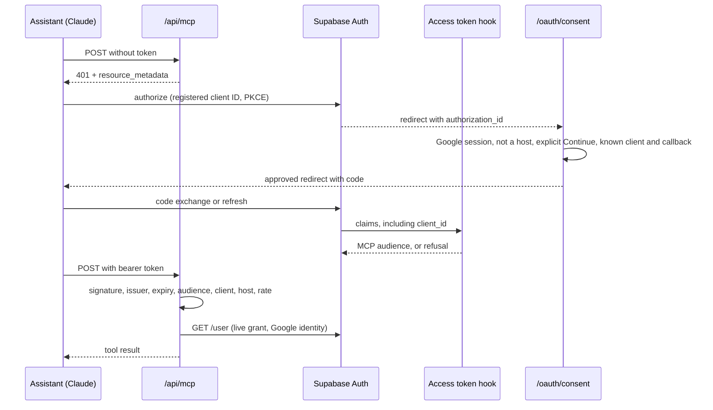

# Read-only MCP endpoint for guest booking

Specification for Phase 2 of [ChatGPT and Claude access to guest booking](2026-11-24-external-agent-access.md). Planning baseline: 2026-11-25, branch `plan/read-only-mcp`, commit `1f618a7` (the `develop` tip on that date), worktree `/Users/juan/code/layalga-plan-mcp`. Planning only. This document authorizes no implementation, push, hosted setting, credential, deployment or client registration.

Claim labels: VERIFIED was read or run in this session, or is recorded as VERIFIED in the [Phase 1 spike](../research/2026-11-25-external-agent-oauth-spike.md). SOURCE was read by a delegated research pass on 2026-11-25 in the named vendor document or source file, and not re-read by the coordinator. INFERRED needs a test that this plan names.

## Outcome

A guest who talks to Claude, and later ChatGPT, can find a listed household, compare dates and rooms, and read the answer to their own requests. The guest signs in with Google and approves the assistant on an L’Ayalga page first. The assistant cannot send, change or withdraw anything. The guest can see and disconnect assistants. Everything ships dark in one release; hosted activation is a separate, step-by-step authorization.

## Accepted decisions

| Decision | Source |
| --- | --- |
| Supabase Auth is the authorization server, under the spike's four conditions | Owner, 2026-11-25 (brief) |
| Data for AI vendors is limited to listing, dates, room terms and status | Owner decision table of the parent plan |
| Pre-registered clients only. Dynamic registration stays off. | Owner, 2026-11-25, this session |
| Web sign-out leaves assistants connected; the product says so and offers a disconnect page | Owner, 2026-11-25, this session |
| Four phases, one dark release | Owner, 2026-11-25, this session |
| Claude pilot first, then both directories | Parent plan |

## Two limits to accept with this plan

1. **The sign-in service exposes the guest's identity to a connected assistant.** VERIFIED in the spike: a client token can call `GET /auth/v1/user` and `/auth/v1/oauth/userinfo`, which return email, identities and metadata. Supabase has no setting for this in the sources read. L’Ayalga's tools never send these fields, and the hook removes email, phone and profile data from the access token, but an assistant vendor that calls Supabase directly can read them. The owner rule "no notes or email" therefore holds for tool data and not for the sign-in service. The consent page and the privacy notice state this in plain words. Acceptance of this plan accepts this limit. A dedicated authorization server would remove it.
2. **A host account cannot connect an assistant**, including an email prepared in `host_identity_claims` that has not signed in. The pilot therefore needs a Google account that belongs to neither host.

## Design

### Request path

### Choices and the decisive tradeoff

| Topic | Selected | Alternative rejected |
| --- | --- | --- |
| Client allowlist | Table `assistant_clients`: exact client ID with one exact `https` callback, `enabled` default false. The hook, the consent page and the resolver all read it. | Callback allowlist alone. With pre-registration the exact client ID is known, and one row is also the fastest kill switch. |
| Hook rights | `security invoker`, run by `supabase_auth_admin` with column grants and RLS policies | The spike's `security definer`. Supabase advises against it (SOURCE, [hook guide](https://supabase.com/docs/guides/auth/auth-hooks)), and Auth already owns `auth.oauth_clients`, so hosted read access is not an assumption about another role. |
| Token role | The hook sets `role` to `layalga_assistant`, a name with no database role | Leave `authenticated`. Every future grant to `authenticated` would then reach connected clients. |
| Bearer verification | `jose` 6.2.10 (already in the lock file) with exact `ES256`, issuer and single-string audience, then `GET /user` with no cache | Supabase `getClaims`: no issuer or audience check, and it is reserved to `src/lib/auth/session-user.ts:10` by `src/lib/auth/session-user-callers.test.ts:9`. |
| Transport | `createMcpHandler` from `@modelcontextprotocol/server` 2.3.0 (already in the lock file through `pnpm-workspace.yaml:75`): stateless, POST only, serves 2026-07-28 and the 2025 revisions | Hand-written JSON-RPC. Claude states the 2025-11-25 authorization revision and Claude Code uses 2026-07-28 where offered (SOURCE), so both eras are needed. |
| Metadata route | `rewrites()` in `next.config.ts` from both `/.well-known/oauth-protected-resource` forms to `src/app/api/mcp/metadata/route.ts` | A dot-prefixed route folder. `tsconfig.json` globs do not include dot folders, so type checks would skip it (INFERRED). |
| Tool names | `find_households`, `search_stays`, `read_request_status` | The WebMCP dotted names. MCP permits dots; no Claude or OpenAI page read confirms them (SOURCE). Schemas are shared, names are not. |
| Status tool input | None. It returns the signed-in guest's own requests. | A request ID. The rule in `.rpi/rules/webmcp.md` forbids IDs that the model cannot see, and an ID would add a probing surface. |
| Server class | The low-level `Server`, with our schemas and our own validation | `McpServer`. It answers schema errors itself with plain text (VERIFIED in 2.3.0), so the recovery contract would not hold. |
| Room references | Not returned | Returning `ref`. No Phase 2 tool accepts it. The search result links to the same search on the website instead. |
| Feature switch | `ASSISTANT_ACCESS=none\|on`, default `none` in every contract, as `EMAIL` does (`src/lib/server/env.ts:110`). It controls consent, the endpoint, the header link and the privacy section. The assistants page works without it, so a guest can always disconnect. | Deploying only when ready. Dark code needs a switch that is off without configuration. |
| Scope | `openid` only in our metadata and challenge | `email`. It adds the address to ID tokens and userinfo. Phase 1 proves `openid` alone; if Auth refuses it, use `email` and record the deviation. |

### What each part refuses

| Case | Hook (issue and refresh) | Consent page | `/api/mcp` |
| --- | --- | --- | --- |
| Web sign-in token (no `client_id`) | Unchanged output | Required | 401 |
| Client not in `assistant_clients`, disabled, or callback differs | 403 | Refusal text, no redirect | 401 |
| Host, or prepared host email | 403 | Refusal text, no redirect | 401 |
| No verified Google identity | Not checked | Sign-in | 401 |
| Wrong audience, issuer, algorithm, signature, expired | Not applicable | Not applicable | 401 |
| Revoked grant | No session, so Auth refuses | Not applicable | 401 through `/user` |
| `ASSISTANT_ACCESS=none` | Not affected | "Switched off" text | 404 |
| Auth, JWKS or database unavailable | SQL error: token request fails | "Try again" text | 503 with `Retry-After` |

Every identity refusal is a 401 `invalid_token`, never a 403. A 403 `insufficient_scope` starts a scope step-up in Claude that cannot succeed (SOURCE). An outage is a 503, so that a short Auth failure does not make assistants drop valid connections.

## Phases

| Phase | Demonstration required before acceptance |
| --- | --- |
| [1. Token policy and bearer resolver](2026-11-25-read-only-mcp-phases/phase-1.md) | On a disposable stack with the hook on, web sign-in and refresh produce unchanged claims, and only an enabled client for a non-host gets a token with the MCP audience. The resolver accepts that token and refuses every variant. |
| [2. Consent and connected assistants](2026-11-25-read-only-mcp-phases/phase-2.md) | A guest signs in, sees who asks and where the answer goes, approves, sees the connection listed and disconnects it. A lookalike client and a host cannot finish. |
| [3. MCP endpoint and read tools](2026-11-25-read-only-mcp-phases/phase-3.md) | An MCP client of each protocol era discovers the server, and calls the three tools with exactly the permitted fields. |
| [4. Acceptance, documents and activation runbook](2026-11-25-read-only-mcp-phases/phase-4.md) | One browser run goes from 401 to a tool result to disconnect. Privacy, architecture and runbook documents match the code. |

Phases run in order, with acceptance after each. Phase 3 needs the resolver from Phase 1 only, but acceptance stays sequential.

## Rate limits

| Limit | Value | Result when exceeded |
| --- | --- | --- |
| Account and client, per minute | 60 POST requests | `tools/call`: tool result `rate_limited` with the wait in seconds, produced by the tool handler so that each protocol era encodes it. Other methods: HTTP 429 with `Retry-After`. |
| Account and client, per 24 hours from the first request | 1,000 POST requests | Same |
| Client, per minute | 1,200 POST requests | HTTP 429 with `Retry-After` |
| Body | 64 KiB, no JSON-RPC arrays | 413 and 400. An array would hide several tool calls behind one count. |
| `subscriptions/listen` | Refused before dispatch | A listen stream would hold a 300-second function (`vercel.json:11`). |

Counts live in PostgreSQL because Vercel instances share nothing else. The count runs after signature verification and before the `/user` call, so an invalid token costs neither, and a valid token cannot flood Auth. A request that the account windows refuse does not count against the client window, so one account cannot spend the capacity of every guest. The numbers are first values; the pilot measures real use.

Registration limit: with dynamic registration off, `POST /oauth/clients/register` returns 403 and the spike's burst of 30 does not apply. The refill rate is disputed: one SOURCE reading of Auth v2.198.0 gives 10 per 5 minutes, and issue [#2952](https://github.com/supabase/auth/issues/2952) says 10 per hour. It is not exposed in the Management API schema (VERIFIED: `UpdateAuthConfigBody` has no such field). Settle it only if publication reopens registration.

## Stuck states and recovery

| State | Who sees what | How it ends | Proof |
| --- | --- | --- | --- |
| Hook error or timeout on web sign-in | Every user: sign-in and hourly refresh fail with an Auth 500 | Operator disables the hook with one prepared Management API call (runbook G2). The web path in the hook reads no table and cannot raise. | Phase 1: web event returns unchanged with all hook grants revoked and the tables renamed inside a rolled-back transaction |
| Hook refuses a client (disabled, host, changed callback) | Assistant shows a connection failure; guest reconnects and reads the reason on the consent page | Guest follows the text, or uses the website link on that page | Phase 2 browser test for each reason |
| Consent request expired (10 minutes, SOURCE), used, or opened by another account | "This request has ended. Return to your assistant and connect again." | New request from the assistant | Phase 2 test on an expired and on a second-account request |
| Guest is signed in with the wrong Google account | The account is shown before anything is bound, with "Use another account" | Sign in again; the request is kept | Phase 2 browser test |
| Guest changes language on the consent page | The same request in the other language | Automatic | Phase 2 locale switch test |
| Google sign-in fails or is cancelled at consent | Consent page with a retry button, request preserved | Retry | Phase 2 callback tests |
| Browser does not navigate after approval | Visible "Return to Claude" link | Guest follows the link | Phase 2 browser test with navigation blocked |
| JavaScript off | `<noscript>` text: sign-in and approval need JavaScript | Guest enables it or uses the website by invitation | Phase 2 render test |
| Auth, JWKS or database unavailable | Assistant gets 503 and "try again in a minute"; the connection stays | Automatic on the next call | Phase 3: fail, then succeed with the same token |
| Rate limit reached | Assistant gets the wait in seconds | Automatic when the window turns | Phase 3 with an injected clock |
| Web session ends while consent is open | The sign-in step, request kept | Sign in and continue | Phase 2 test with 401 and 403 from the details call |
| Publishable key wrong or rotated | Assistants get 503; the website itself also fails | Operator corrects the key; connections survive | Phase 1 resolver test with an invalid key |
| Grant revoked, then assistant calls | 401; assistant offers to reconnect | Guest approves again | Phase 4 browser run |
| Refresh token no longer valid | Auth answers `refresh_token_not_found` without `invalid_grant` (VERIFIED); Claude's reaction is UNVERIFIED | If Claude does not offer to reconnect, the guest removes and adds the connector. The assistants page says this. | Phase 4 page text test; pilot check P3 |
| Disconnect fails | Page keeps the row and shows "not disconnected, try again" | Retry | Phase 2 test with a failed revoke |
| OAuth server off while connections exist | Assistants page: assistants cannot use these connections now and the list is unavailable | Ends when the server is on again; nothing to do meanwhile | Phase 2 test with `feature_disabled` |
| `ASSISTANT_ACCESS` and the token audience disagree in production | `/api/health` is degraded with key `APP_URL` | Operator corrects the value | Phase 3 environment test |

## Consumer sweep

Searches ran at the baseline with `rg`-equivalent `grep -rnlw <symbol> src scripts tests supabase/migrations next.config*`. A Graphify call query (`graphify_local`, generation 2026-11-25) showed the same action and page callers for the booking functions; its output was truncated, so the text search is the evidence. Repeat the search in the implementation worktree.

| Changed surface | Consumers found | Disposition |
| --- | --- | --- |
| Access token claims (hook) | Every Auth token. Web readers: `src/lib/auth/session-user.ts`, `src/lib/supabase/proxy.ts`. Local sign-in writers: `src/test-support/host-session.ts`, `tests/e2e/helpers/requester.ts` | Phase 1. Web output must be identical; the full E2E suite runs with the hook on. |
| `stayQuery`, `lookupHouseholds`, `lookupStays` (logic moves to core) | `src/app/[locale]/stays/actions.ts`, `stays/page.tsx`, `stays/[handle]/page.tsx`, `actions.test.ts`, `src/components/webmcp/public-registration.tsx` | Phase 3. Signatures and results of the actions stay the same. |
| WebMCP input schemas (moved to a shared module) | `src/components/webmcp/public-tools.ts`, `public-tools.test.ts` | Phase 3. The WebMCP objects must be deeply equal before and after. |
| `listRequesterStayRequests` (new reader, unchanged function) | `src/app/[locale]/requests/page.tsx`, `src/core/booking/guest-conversation.ts`, integration test | Phase 3 projects its result. No change to the function. |
| `localeSwitchHref` (keeps only listed query keys) | `src/components/frontend-utils.ts:7` and its tests | Phase 2 adds the consent path with a validated `authorization_id`. Without it, changing language loses the request. |
| `next.config.ts` request-log filter | `next.config.test.ts` | Phase 2 adds `authorization_id` to the ignored query keys. |
| Grants and policies on `hosts`, `host_identity_claims` | Tests that assert privileges: `public-listings`, `invitations`, `stay-requests`, `guest-delivery` and `policy/settings` integration tests | Phase 1 runs them unchanged; they assert the runtime roles and not `supabase_auth_admin`. |
| `playwright.config.ts` `e2eEnv` | All E2E specs | Phase 2 sets `ASSISTANT_ACCESS=on` there; unit and integration tests set each value themselves. |
| `safe-next-path.ts` (one new predicate) | `isRequesterPath`: callback route. `isStaySearchPath`: sign-in page, callback route, `frontend-utils.ts`, `stay-sign-in-path.ts`. `safeNextPath`: prepare route, `oauth-next.ts` | Phase 2 adds `isAssistantConsentPath` and a callback branch. Existing predicates do not change. |
| `session-user-callers.test.ts` guard | Itself | Phase 1 adds a second guard: only the bearer resolver may call `/auth/v1/user`. The existing allowlist does not grow. The guard matches any `fetch` whose URL ends in `/user`. Grant calls use `supabase.auth.oauth` and stay outside its pattern. |
| `private.apply_data_retention` (wrapped again) | `src/core/data-retention.ts`, `stay-requests.integration.test.ts`, `guest-delivery.integration.test.ts`, `data-retention.integration.test.ts`, cron | Phase 1. Extra result key only. |
| `parseServerEnvironment` (one new optional mode) | The importers listed by the search, including the agent process | Phases 2 and 3. Default `none`; no new required variable in any contract. |
| `next.config.ts` (adds `rewrites`) | `next.config.test.ts` | Phase 3. |
| `messages/en.json`, `messages/es.json` `Privacy` | `src/app/[locale]/privacy/page.tsx:10`, `page.test.tsx` | Phase 2 adds namespace `Assistants`; Phase 4 adds one privacy section in both languages. |
| `supabase/config.toml` (hook and OAuth server on locally) | Local stacks, CI `integration` and `acceptance` jobs (`.github/workflows/ci.yml:63`, `:100`) | Phase 1. No script, workflow or document runs `supabase config push` (VERIFIED); a test keeps it so. No Supabase check suite exists on `main` (VERIFIED for the current head), so no GitHub integration was seen applying the file. The runbook rechecks both. |
| AgentCore bundle | `src/agent/**` | Excluded. Agent modules import `env.ts`, where the new mode is optional with a default, and nothing from `src/mcp` or the resolver. AgentCore needs no deployment. A bundle check in Phase 4 proves the second part. |
| Release probes, fixture households | `scripts/release-probes.ts`, `src/test-support/fixture-household.ts` | Excluded. No probe is added; see below. |

## Release-system impact

No check joins the release critical path. New tests run in the existing CI jobs. A new local probe would repeat the Phase 4 browser run, which the release-gate rule calls a finding. Activation proofs in the runbook are owner-run operational steps (Class B for identity and rollback of a hosted setting); they gate the activation and no release.

## Open compatibility points for the pilot

| Point | What this plan does | Pilot check |
| --- | --- | --- |
| `refresh_token_not_found` without `invalid_grant` | Discloses the manual recovery. A token proxy to translate the error is out of scope. | P3: revoke, wait past expiry, record what Claude shows |
| No client ID metadata documents | Pre-registered client. Claude's dialog accepts a client ID without a secret (SOURCE: [custom connectors](https://claude.com/docs/connectors/custom/add-unlisted.md)) | P1: connect with the registered ID |
| No `iss` in the authorization response | ChatGPT then uses a callback specific to the connection (SOURCE). One exact row for each connection | P5: only when the owner starts ChatGPT |
| ChatGPT entry of a predefined client ID | UNVERIFIED. The documents name predefined clients and describe no field | P5: if it is not possible, ChatGPT waits for publication |
| Loopback port matching | Claude Code is not supported in this phase. The table accepts `https` callbacks only, so it is refused with the consent text | None. Revisit with `--callback-port` if wanted |
| Connection mix-up (login CSRF): a person sends their own assistant's consent link to a guest | The page says to continue only if the guest just started this, needs a click before it binds or approves, and never navigates alone for an earlier consent. The rest depends on the vendor binding `state` to its own session, which is UNVERIFIED | P6: open another assistant account's link and confirm that the vendor rejects the return. A failure stops the pilot |
| Origin header from assistants | Absent, our own origin, `https://claude.ai` and `https://chatgpt.com` pass; others get 403 as MCP requires | P2: record the header Claude sends |
| `/user` on every call | 3-second limit, no cache | P4: record p50 and p95 for 50 calls |

## Out of scope

Prepare and send (parent Phase 3), directory submission, dynamic registration, Claude Code, unauthenticated tool listing, per-tool scopes, notifications, resources, prompts, and any change to web sign-out.

## Verification

Each phase follows red, green, independent review, repair, simplify, then this sequence, run once in order on a disposable task-owned Supabase stack (unique `project_id` and ports, per `.rpi/rules/resource-lifecycle.md`): `bash scripts/verify-bootstrap.sh`, `pnpm run typecheck`, `pnpm run lint`, `pnpm run test`, `pnpm run build`, from Phase 3 a smoke of the production server (`next start` with named environment, see Phase 3), `pnpm run test:e2e`, `pnpm run release:probes -- --target local --base http://127.0.0.1:3008`. Add each new database test to both lists in `package.json` (`test:integration` includes; `test:unit` excludes every `*.integration.test.ts` by pattern, so use that suffix). Remove `.next/dev` before the build that follows E2E. Finish the stack lifecycle before acceptance.

CI starts Supabase with CLI 2.116.0 and the spike used 3.3.0. Phase 1 also runs its integration tests with CLI 2.116.0. If that Auth version lacks a needed behavior, stop and report it: a workflow change follows the Sutura ownership rule.

## Handoff

- **Objective and scope:** specification only, for owner review. Next workflow: `/rpi-implement` Phase 1 in a new isolated worktree from `develop`, after acceptance. Another session prepares v2.5.3 on `develop`; rebase the implementation base onto the released commit.
- **Entry conditions for Phase 1:** this plan accepted, including both limits above. No hosted action is needed for Phases 1 to 4.
- **Evidence:** repository reads and searches at `1f618a7`; spike branch `spike/external-agent-oauth` read and not merged; installed type declarations for `@supabase/auth-js` 2.119.2 and `@modelcontextprotocol/server` 2.3.0; Supabase CLI 3.3.0 strings and the public Management API schema for setting names. Vendor documents are SOURCE claims.
- **Not run:** no test, stack, hosted read or client connection. Docker was listed only; a stack `layalga-rel253` belongs to the other session and was not touched.
- **Review:** one independent read-only review on 2026-11-25 returned 23 findings (6 high, 9 medium, 8 low). All were accepted and are in this text. It did not read Auth source, hosted roles or vendor documents, and it ran no test.
- **Overlay:** no `.rpi/project/rpi-plan.md` exists; no declared override was applied.
- **Local resources:** none allocated. The worktree stays until the owner accepts or rejects the plan.
